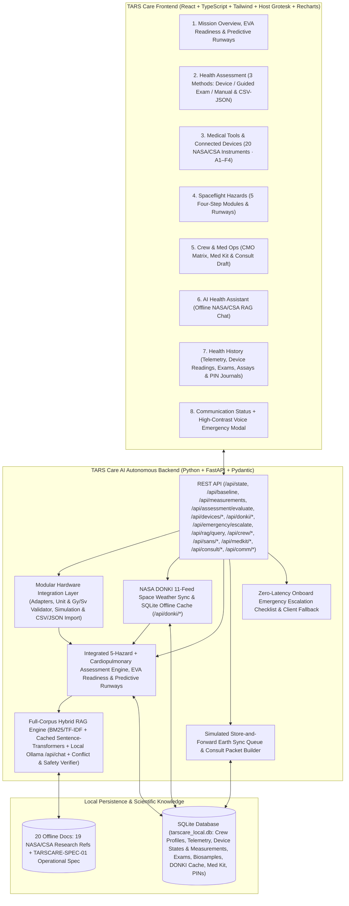

# TARS Care — Your Personal Health Companion in Deep Space
**NASA Space Apps Challenge 2026 · Team Milky Has Its Own Way**

**TARS Care** is a calm, offline-first autonomous health-monitoring and self-assessment web application designed for astronauts on long-duration deep-space missions, particularly Mars missions. Built atop the **TARS Care** FastAPI + SQLite + local RAG backend (`backend/`, `tarscare_local.db`, `/api/*`), TARS Care enables astronauts to answer three urgent questions at a glance — **How am I doing?**, **What has changed?**, and **Should I take any action?** — explore their body systems interactively, monitor NASA's five human-spaceflight hazards, run self-assessments with dual manual/symptom entry, and consult offline NASA & CSA research without relying on Earth connectivity.

---

## 1. System Architecture



---

## 2. Quick-Start Installation & How to Run

### Prerequisites
- **Python 3.10+** (`fastapi`, `uvicorn`, `pydantic`, plus optional local `sentence-transformers` or local `ollama` if available)
- **Node.js 18+** and `npm`

### Step 1: Start the Local Backend Server (`http://127.0.0.1:8000`)
```powershell
cd backend
pip install -r requirements.txt
python -m uvicorn main:app --host 127.0.0.1 --port 8000
```
On startup, `backend/database.py` initializes or non-destructively migrates `backend/tarscare_local.db` with 30 Sols of realistic synthetic Mars mission telemetry (`Sol 155–184`), personal baseline calibration audit storage, and 16 pre-bundled offline documents (`15` NASA/CSA research references plus `TARSCARE-SPEC-01` operational safety specification).
- **Offline Semantic RAG & Local Ollama LLM (`127.0.0.1:11434`):**
  - Install [Ollama](https://ollama.com) locally and pull an offline chat model (for example `ollama pull qwen2.5:3b` or `ollama pull llama3.2:3b`), plus optional embedding model `ollama pull nomic-embed-text`.
  - `backend/local_ai_rag.py` probes `http://127.0.0.1:11434/api/tags` (filtering out embedding-only models), runs full-corpus hybrid retrieval blending TF-IDF lexical relevance with locally cached `all-MiniLM-L6-v2` embeddings (`HF_HUB_OFFLINE=1` — zero cloud requests), injects live telemetry and personal baseline comparisons for `SuChai`, synthesizes grounded answers via `/api/chat` (`keep_alive: 15m`), and verifies `[DOC-ID]` citations and medication safety constraints before returning responses.
  - If Ollama is stopped or toggled off (`POST /api/ai/config`), TARS Care falls back automatically to deterministic offline RAG (`OFFLINE_SENTENCE_TRANSFORMERS` or `DETERMINISTIC_OFFLINE_RAG`).

### Step 2: Start the TARS Care Frontend (`http://127.0.0.1:5173`)
In a second terminal:
```powershell
cd frontend
npm install
npm run dev -- --host 127.0.0.1 --port 5173
```
Open **http://localhost:5173** in your browser. Vite proxies `/api/*` requests to `http://127.0.0.1:8000`.

### Step 3: Automated Safety & Build Verification
```powershell
# Backend medical safety, API, offline RAG, hardware, DONKI & sync tests (isolated temp SQLite DB)
python -m pytest backend/tests/test_tarscare_safety.py -v

# Frontend TypeScript check and production bundle
cd frontend
npx tsc --noEmit
npm run build
```

### Optional NASA DONKI & InSight Weather Live API Key Configuration
- **NASA DONKI Space Weather (`CME`, `CMEAnalysis`, `GST`, `IPS`, `FLR`, `SEP`, `MPC`, `RBE`, `HSS`, `WSAEnlilSimulations`, `notifications`)**: Auto-syncs the last 30 UTC days concurrently on startup when online and renders under **Spaceflight Hazards → Space Radiation** and **Communication Status**, persisting events in SQLite (`donki_events`).
- **NASA InSight Mars Weather (`AT`, `HWS`, `PRE`, `WD` 16-sector wind rose & `validity_checks`)**: Caches archival Elysium Planitia per-Sol surface weather in SQLite (`insight_weather_sols`) under **Spaceflight Hazards → Hostile Environments** and **Communication Status** without mutating pressurized habitat ECLSS telemetry.
- Create `backend/.env` (excluded via `.gitignore`) or set `NASA_API_KEY` in the process environment (falls back to `DEMO_KEY` if omitted). Keys remain strictly server-side and are never serialized to the frontend.

---

## 3. Eight Core Navigation Views

1. **Mission Overview** — Opens immediately with a **3-question crew wayfinding triage band** (*How am I doing?*, *What has changed?*, *Should I take any action?*), centered **Interactive Human Body** with 7-Sol sparklines and baseline comparisons, **Autonomous EVA Readiness (`GO` / `CAUTION` / `HOLD`)** with blocking/advisory considerations and interactive **SANS Amsler Grid** launch, **Deterministic Predictive Threshold Runways** (`Cabin CO₂`, `Cumulative Radiation Budget`, `7-Sol Sleep Debt Recovery`, `Musculoskeletal Strength`), **Vital Signs vs. Personal Baseline** (`BPM`, `mmHg`, `SpO₂`, `°C`, sleep, explicit `Mood` and `Stress` scores), **Five Spaceflight Hazard** cards, dual-axis **7 / 14 / 30-Sol Health Trends**, **Important Alerts & Prioritized Actions**, and direct **Personal Baseline Calibration** (`GET/POST /api/baseline`).
2. **Health Assessment** — Supports **three data collection workflows**: **Method A (Connect Medical Device)** with truthful hardware probing vs labeled Simulation Mode & one-click field population, **Method B (Start Medical Examination)** launching guided ultrasound, ocular tonometry/SANS, balance, ergometer, thigh-cuff, Radi-N2, and biosample workflows, and **Method C (Manual Input & CSV/JSON Telemetry Import)** preserving manual entry alongside validated unit/Gy-vs-Sv checks, **Voice Symptom Capture**, and **Behavioral Check-In**.
3. **Medical Devices (`Medical Tools & Connected Devices`)** — Organized 20-instrument NASA/CSA catalogue spanning **Category A (Wearables: ARCHeR Actigraphy, CSA Bio-Monitor, CARDIOBREATH BP Cuff, Thigh Cuffs)**, **Category B (Imaging: Ultrasound, Eye-Pressure/SANS, MRI, TBone 3D Scanner)**, **Category C (Radiation: EVARM MOSFET, Radi-N2, Automatic Bubble Reader, CANS Spectrometer)**, **Category D (Tempus Pro, Artemis Integrated Health Concept)**, **Category E (Saliva Blotting Booklets, Biological Sampling Kits with separate Lab Assay Import)**, and **Category F (Behavioural Surveys, Posturography Balance, Cycle Ergometer/AstroFit, Veggie Space Gardening)**. Strictly separates Simulated Mode from Connected Hardware and blocks non-vital equipment from fabricating vital signs.
4. **Spaceflight Hazards** — Detailed modules for **Space Radiation**, **Isolation & Confinement**, **Distance from Earth**, **Gravity Fields** (with `1g` / `0g` / `0.38g` explorer, exercise-hold warnings, and integrated SANS screening status), and **Hostile and Closed Environments**. Each displays dual-series 14-Sol charts (`mSv/day` vs `mGy`, `CO₂` vs `Cabin Temp`), per-hazard **Deterministic Predictive Runway** projections, four-step guidance, and synced configured warning threshold controls.
5. **Crew & Med Ops** — Multi-crew switcher and severity-sorted **CMO Triage & EVA Readiness Matrix** across all 4 Ares-Horizon IV crew members (`ARES-IV-SUCHAI`, `ARES-IV-VANCE`, `ARES-IV-CHEN`, `ARES-IV-OKAFOR`) with private behavioral journals redacted in the fleet view, **SHA-256 Privacy PIN** unlock/re-lock (`DEFAULT_DEMO_PIN = "2026"` for local demo verification), 7-item **Onboard Medical Operations Kit** reserve tracker (with CMO/Flight Surgeon authorization lock on medications), and a one-click **Delayed Flight-Surgeon Consult Draft Builder** queuing sanitized Markdown packets into Store-and-Forward without private diaries or automated prescriptions.
6. **AI Health Assistant** — Offline-first companion backed by `/api/rag/query`, live Ollama model selector & `Local LLM` toggle, full-text **Offline Document Reader** (`Read Offline` modal without requiring external internet URLs), explicit **Conflict & Regime Distinction Notices**, separated **NASA/CSA Scientific Evidence** vs **TARS Care Operational Procedures**, and strict medication/out-of-scope surgical refusal plus post-LLM safety verification gates.
7. **Health History** — Filter longitudinal physiological logs (`7d` / `14d` / `30d`, `All Data` / `Simulated` / `User-Entered`), review **Connected Device Measurements (`SIMULATED DEMO` vs imported), Guided Examinations, and Biological Specimen Lab Assays**, inspect **Behavioral & Sleep Check-In History** protected behind **PIN-Gated Private Reflections**, and export comprehensive Markdown reports locally.
8. **Communication Status & High-Contrast Emergency Triage** — Switch between **Connected**, **Delayed (Mars Nominal)**, and **Offline (Blackout)**, verify **Store-and-Forward** queue blocking during `OFFLINE` blackout (`BLOCKED_OFFLINE`) and synchronization on reconnect, manage Local Ollama + Offline RAG diagnostics, and open zero-latency Emergency Escalation Checklists featuring **EVA High-Contrast Focus Mode**, elapsed triage timer, step completion checkboxes, client-side fallback, and offline Web Speech readout/voice triage controls.

---

## 4. Scientific Accuracy, Provenance & Medical Safety Guardrails

- **Deterministic Critical Priority & Exercise Safety Gate:** All recommendations sort strictly `IMMEDIATE > HIGH > ROUTINE`. During `CRITICAL` vitals, hypoxemia (`SpO₂ < 94%`), presyncope, or cardiopulmonary red-flag symptoms, routine exercise/ARED prescriptions are suppressed and replaced with explicit Exercise Hold instructions and mandatory Crew Medical Officer (CMO) hardware/ECG gap notices.
- **Radiation Unit Separation:** Always preserves and separates physical **absorbed dose (`Gy` / `mGy`)** from biologically weighted **equivalent/effective dose (`Sv` / `mSv`)**; never invents NASA-approved flight limits (user-configurable alert thresholds are explicitly labeled non-NASA prototype defaults).
- **NASA RDP / ARMAS Context:** Explicitly states that ARMAS measurements represent Earth high-altitude aircraft datasets benchmarking dosimetry pipelines, not direct Martian surface dosimetry.
- **Non-Diagnostic, Non-Prescribing & Prototype Boundary:** Tracks mood, stress, sleep, and cabin environment trends without automatically diagnosing psychiatric conditions or clinical infections, refuses medication dosage or invasive/surgical procedure requests, and is a software prototype decision-support aid — **not** clinically certified or flight-qualified medical software.
- **Explicit Data Provenance:** Distinguishes `Simulated Data`, `User-Entered Data`, `Simulated Env`, `Real Research Data`, and `System Operational Spec` throughout UI, SQLite persistence, and exported reports.
