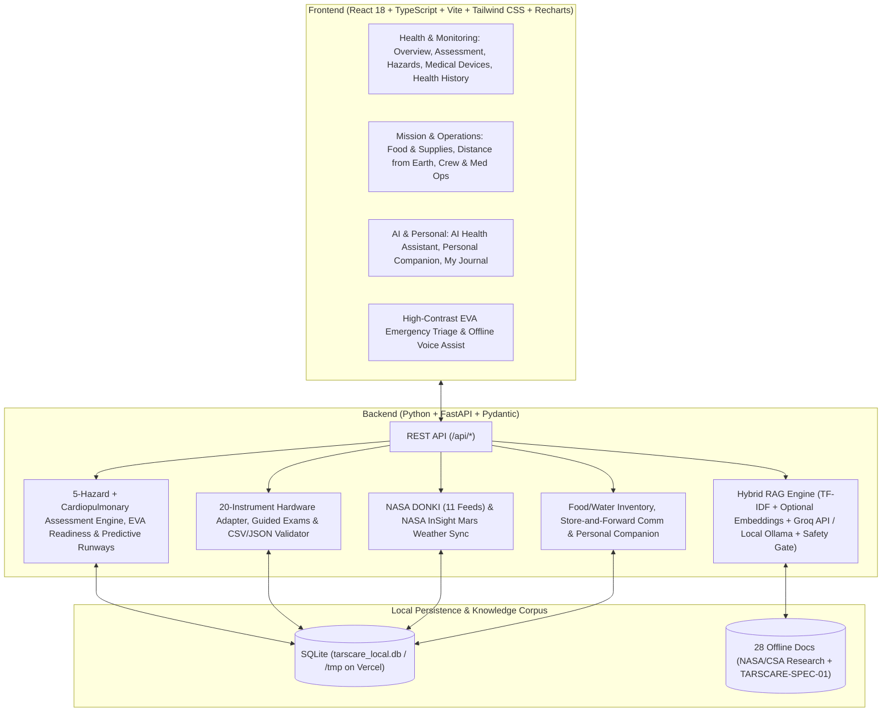

# TARS Care — AI Astronaut Health Companion

> **NASA Space Apps Challenge 2026 · Team Milky Has Its Own Way**
>
> An offline-first, autonomous astronaut health-monitoring, self-assessment, and medical decision-support web application designed for long-duration deep-space and Mars missions.

TARS Care unifies physiological and psychological telemetry, personal baseline tracking, NASA human-spaceflight hazard analysis, crew medical operations, and a citation-backed Retrieval-Augmented Generation (RAG) assistant in a single calm interface. Built to operate reliably across **Connected**, **Delayed (Mars nominal light-time)**, and **Offline (Conjunction Blackout)** states, it helps crew members answer three urgent questions at a glance: **How am I doing?**, **What has changed?**, and **Should I take any action?**

---

## Table of Contents

- [Features](#features)
- [System Architecture](#system-architecture)
- [Tech Stack](#tech-stack)
- [Project Structure](#project-structure)
- [Getting Started](#getting-started)
  - [Prerequisites](#prerequisites)
  - [Environment Variables](#environment-variables)
  - [Installation & Running Locally](#installation--running-locally)
- [Usage & Application Views](#usage--application-views)
- [Deployment (Vercel)](#deployment-vercel)
- [Testing & Verification](#testing--verification)
- [Scientific Accuracy & Safety Guardrails](#scientific-accuracy--safety-guardrails)
- [Contributing](#contributing)
- [Team & License](#team--license)

---

## Features

- **Three-Question Mission Overview & Interactive Body Map:** Answers *How am I doing?*, *What has changed?*, and *Should I take any action?* with an interactive 7-region anatomical centerpiece (`Head and Brain`, `Eyes`, `Heart`, `Lungs`, `Muscles`, `Bones`, `Whole Body`), 7/14/30-Sol trend charts, **EVA Readiness (`GO` / `CAUTION` / `HOLD`)**, and deterministic predictive threshold runways (`Cabin CO₂`, `Cumulative Radiation Budget`, `7-Sol Sleep Debt Recovery`, `Musculoskeletal Strength`).
- **Multi-Modal Health Assessment:** Collect telemetry via **Simulated/Connected Medical Devices** (20 NASA/CSA instruments in `HARDWARE_CATALOG`), **Guided Medical Examinations** (including SANS Amsler grid, ocular tonometry, ultrasound, ergometer, and biosample workflows), or **Manual Entry & CSV/JSON Import** with unit and `Gy` vs. `Sv` validation.
- **Five Spaceflight Hazards Monitoring:** Dedicated 4-step modules for **Space Radiation**, **Isolation & Confinement**, **Distance from Earth**, **Gravity Fields** (`1g` / `0g` / `0.38g` explorer + exercise-hold gating), and **Hostile & Closed Environments**.
- **Hybrid Offline-First AI Health Assistant & Personal Companion:** Queries **28 pre-bundled documents** (NASA HRP, OSDR, RadLab, NLSP, EDA, CSA studies, plus `TARSCARE-SPEC-01`) using TF-IDF lexical scoring, optional locally cached `sentence-transformers` (`all-MiniLM-L6-v2`), and optional **Groq API** or **local Ollama** synthesis with automatic **deterministic offline RAG fallback**, `[DOC-ID]` citations, and post-generation safety gates. Includes a **Personal Companion** & **SHA-256 PIN-gated Journal** (`DEFAULT_DEMO_PIN = "2026"`).
- **Food, Water & Medical Operations:** Tracks crew rations, potable water reserves, expiry alerts, nutrition targets, a 7-item onboard medical kit, multi-crew **CMO Triage Matrix** (`ARES-IV-SUCHAI`, `ARES-IV-VANCE`, `ARES-IV-CHEN`, `ARES-IV-OKAFOR`), and **Store-and-Forward Flight Surgeon Consult Packets**.
- **Space Weather & Mars Environmental Feeds:** Server-side integration with **11 NASA DONKI space-weather feeds** and **NASA InSight Mars Weather** (`Elysium Planitia`), persisted in SQLite for offline viewing.
- **Zero-Latency Emergency Triage:** High-contrast EVA emergency checklist modal with timer, offline Web Speech readout/voice capture, and client-side fallback when offline.

---

## System Architecture



---

## Tech Stack

| Layer | Technologies | Why We Chose Them |
| :--- | :--- | :--- |
| **Frontend** | React 18, TypeScript, Vite, Tailwind CSS, Recharts, Lucide React, Host Grotesk | Fast SPA rendering, dark-ambient spacecraft readability, responsive layouts, and tabular-numeric telemetry charts. |
| **Backend** | Python 3.10+, FastAPI, Pydantic | Typed API validation, lightweight runtime footprint, and clean integration with Vercel Python Functions. |
| **Persistence** | SQLite (`sqlite3`) | Zero-infrastructure, offline-first persistence for 30 Sols of telemetry (`Sol 155–184`), baselines, device logs, food/med-kit reserves, and sync queues. |
| **AI & Retrieval** | Custom TF-IDF + Hybrid Dense RAG, Groq API (`GROQ_API_KEY`), Optional Local Ollama & `sentence-transformers` | Guarantees deterministic, citation-verified answers offline while supporting cloud or local LLM synthesis when available. |
| **Space Feeds** | NASA DONKI API, NASA InSight Mars Weather API | Grounds habitat and radiation views in real space-weather events and archival Mars surface telemetry with offline caching. |
| **Deployment** | Vercel Services (`vercel.json`) | Ships the Vite SPA and FastAPI backend under a single origin (`/api/*` -> backend, `/*` -> frontend). |

---

## Project Structure

```text
.
├── backend/
│   ├── assessment_engine.py    # 5-hazard rules, baseline deltas, EVA readiness & runways
│   ├── database.py             # SQLite schema, migrations & 30-Sol synthetic crew seeder
│   ├── donki_client.py         # NASA DONKI 11-feed concurrent client & SQLite cache
│   ├── donki_routes.py         # /api/donki/* endpoints
│   ├── hardware_devices.py     # 20-instrument NASA/CSA device catalog & simulation logic
│   ├── hardware_routes.py      # /api/devices/* endpoints
│   ├── insight_client.py       # NASA InSight Mars weather client & Sol parser
│   ├── insight_routes.py       # /api/insight/* endpoints
│   ├── knowledge_base.py       # Base NASA/CSA corpus & TF-IDF chunk retriever
│   ├── local_ai_rag.py         # Hybrid RAG, Groq/Ollama integration & safety verifier
│   ├── main.py                 # FastAPI entrypoint, core /api/* routes & serverless DB guard
│   ├── marscare_enhancer.py    # Comm-mode normalization & recommendation prioritization
│   ├── marscare_routes.py      # /api/ai/*, /api/assessment/evaluate, /api/history, /api/reports/*
│   ├── mission_ops.py          # 4 crew profiles, SHA-256 PIN hashing, med kit & consult packets
│   ├── models.py               # Pydantic schemas and enums
│   ├── support_modules.py      # Food & water inventory, comm queue & companion/journal logic
│   ├── support_routes.py       # /api/food/*, /api/comm/*, /api/companion/*, /api/journal/*
│   ├── requirements.txt        # Minimal Python dependencies (fastapi, uvicorn, pydantic)
│   └── tests/
│       └── test_tarscare_safety.py  # Automated medical safety, RAG & API test suite
├── frontend/
│   ├── public/                 # Favicon and human anatomy visual asset
│   ├── src/
│   │   ├── components/         # Feature views, modals, AI switcher, charts & voice helpers
│   │   ├── App.tsx             # Navigation shell (11 views across 3 groups) & emergency modal
│   │   ├── index.css           # Tailwind & Host Grotesk global styling
│   │   └── types.ts            # TypeScript contracts matching backend payloads
│   ├── package.json
│   ├── tailwind.config.js
│   └── vite.config.ts          # Dev proxy (/api -> http://127.0.0.1:8000)
├── start_tarscare.ps1          # One-command Windows PowerShell launcher
├── vercel.json                 # Vercel Services configuration (Vite frontend + FastAPI backend)
└── .vercelignore               # Deployment exclusions (.env, local DB, caches, tests)
```

---

## Getting Started

### Prerequisites

- **Python 3.10+** (tested with Python 3.12)
- **Node.js 18+** and **npm**
- *(Optional)* **Groq API Key** (`GROQ_API_KEY`) for cloud LLM synthesis or **[Ollama](https://ollama.com)** locally (`127.0.0.1:11434`, e.g., `qwen2.5:3b` or `llama3.2:3b`) for local LLM synthesis. TARS Care operates fully offline without either using its deterministic RAG engine.

### Environment Variables

All environment variables are optional. Create `backend/.env` for local development if you want custom API keys or models (do not commit `.env` files):

```ini
# Optional: NASA Open API key for higher DONKI/InSight rate limits (defaults to DEMO_KEY)
NASA_API_KEY=your_nasa_api_key

# Optional: Groq API key for cloud LLM synthesis in AI Health Assistant & Personal Companion
GROQ_API_KEY=your_groq_api_key

# Optional: Default Groq chat model override (default: qwen/qwen3.8-27b)
TARSCARE_API_MODEL=qwen/qwen3.8-27b

# Optional: Custom SQLite file path (defaults to backend/tarscare_local.db locally, /tmp on Vercel)
TARSCARE_DB_PATH=
```

### Installation & Running Locally

1. **Clone the repository**
   ```bash
   git clone https://github.com/TanSuChin/NASASpaceChallenge2026-Milky_Has_Its_Own_Way.git
   cd NASASpaceChallenge2026-Milky_Has_Its_Own_Way
   ```

2. **Install backend and frontend dependencies**
   ```bash
   cd backend
   pip install -r requirements.txt
   cd ../frontend
   npm install
   cd ..
   ```

3. **Start the application**

   - **Option A — Two terminals (cross-platform):**
     ```bash
     # Terminal 1: Start FastAPI backend (http://127.0.0.1:8000)
     cd backend
     python -m uvicorn main:app --host 127.0.0.1 --port 8000
     ```
     ```bash
     # Terminal 2: Start Vite frontend (http://127.0.0.1:5173)
     cd frontend
     npm run dev -- --host 127.0.0.1 --port 5173
     ```

   - **Option B — Windows PowerShell one-command launcher:**
     ```powershell
     .\start_tarscare.ps1
     ```

   Open **http://localhost:5173** in your browser. Vite proxies all `/api/*` calls to `http://127.0.0.1:8000`.

---

## Usage & Application Views

On first launch, `backend/database.py` automatically seeds 30 Sols (`Sol 155–184`) of synthetic Mars mission telemetry for the 4-person **Ares-Horizon IV** crew.

### Navigation Views (11 Screens in 3 Groups)

1. **Health & Monitoring**
   - **Mission Overview:** 3-question wayfinding band, Interactive Human Body, EVA Readiness (`GO`/`CAUTION`/`HOLD`), Predictive Threshold Runways, vitals vs. personal baseline, and 7/14/30-Sol trend charts.
   - **Health Assessment:** Device data capture, guided medical examinations, manual entry, CSV/JSON import, voice symptom capture, and behavioral check-ins.
   - **Spaceflight Hazards:** Detailed modules for all 5 NASA human-spaceflight hazards with dual-series 14-Sol charts and configurable prototype alert limits.
   - **Medical Devices:** 20-instrument NASA/CSA hardware catalog (Wearables, Imaging, Radiation, Integrated Health, Biosampling, Behavioral/Performance) separating `Simulated` and `Connected` states.
   - **Health History:** Filterable longitudinal telemetry, device measurements, guided exams, lab assays, and Markdown report export.
2. **Mission & Operations**
   - **Food & Supplies:** Ration and potable water inventory, consumption/resupply logs, expiry alerts, and nutritional target tracking.
   - **Distance from Earth:** Live `Connected` / `Delayed (Mars Nominal)` / `Offline (Blackout)` simulation toggle, store-and-forward queue, and NASA DONKI / InSight sync controls.
   - **Crew & Med Ops:** Crew switcher, CMO triage matrix, onboard med-kit inventory, Privacy PIN management (`DEFAULT_DEMO_PIN = "2026"`), and Flight Surgeon consult packet builder.
3. **AI & Personal**
   - **AI Health Assistant:** Citation-backed NASA/CSA RAG Q&A, AI Provider Switcher (Local / Groq API / Deterministic Offline), and offline full-text document reader.
   - **Personal Companion:** Supportive reflection and stress-management companion with safety and exercise-contraindication guardrails.
   - **My Journal:** SHA-256 PIN-protected private behavioral reflections excluded from fleet triage and Earth-sync packets.

### Key API Endpoints

| Endpoint | Method | Purpose |
| :--- | :--- | :--- |
| `/api/health` | `GET` | Liveness and offline-readiness check |
| `/api/state` | `GET` | Full hydrated crew, telemetry, assessment, device, food, comm & RAG state |
| `/api/baseline` | `GET`, `POST` | Read or recalibrate personal crew baselines |
| `/api/assessment/evaluate` | `POST` | Submit manual measurements & symptom checklists for integrated evaluation |
| `/api/rag/query` | `POST` | Query the 28-doc NASA/CSA corpus with safety & citation verification |
| `/api/emergency/escalate` | `POST` | Generate zero-latency emergency checklists and queue escalation packets |
| `/api/reset` | `POST` | Reset the local SQLite database to the seeded 30-Sol demo state |

---

## Deployment (Vercel)

This repository includes [vercel.json](vercel.json) (configured with **Vercel Services**, in Beta on all plans) and [.vercelignore](.vercelignore) to deploy both the Vite frontend and FastAPI backend in one Vercel project:

- **Routing:** `/api/(.*)` routes to the Python FastAPI service (`backend/main.py` -> `main:app`), while `/(.*)` routes to the Vite static frontend (`frontend/` with SPA `/index.html` fallback).
- **Serverless SQLite Handling:** When `VERCEL` is set (or `backend/` is read-only), `backend/database.py` automatically places the SQLite database in `/tmp/tarscare_local.db`, and middleware in `backend/main.py` initializes and seeds it on cold start. *(Note: `/tmp` in Vercel Functions is ephemeral across cold starts and scaling instances; attach an external database for multi-user durable cloud persistence.)*
- **Deploy via CLI:**
  ```bash
  npx vercel login
  npx vercel --prod
  ```
- **Optional Vercel Environment Variables:** Add `GROQ_API_KEY`, `TARSCARE_API_MODEL`, and `NASA_API_KEY` as sensitive variables in **Project Settings → Environment Variables**. Without them, the deployment runs using `DEMO_KEY` and deterministic offline RAG.

---

## Testing & Verification

Run the automated backend safety, medical rule, RAG, hardware, DONKI, and offline integrity test suite (`26` tests in an isolated temp SQLite database):

```bash
python -m pytest backend/tests/test_tarscare_safety.py -v
```

Run frontend TypeScript validation and production build verification:

```bash
cd frontend
npx tsc --noEmit
npm run build
```

---

## Scientific Accuracy & Safety Guardrails

- **Prototype Boundary:** TARS Care is a software decision-support prototype — **not** clinically certified or flight-qualified medical software. It tracks trends without diagnosing psychiatric disorders or infections and refuses medication dosing or invasive/surgical instructions.
- **Strict Priority & Exercise Safety Gate:** Recommendations sort strictly `IMMEDIATE > HIGH > ROUTINE`. During `CRITICAL` vitals, hypoxemia (`SpO₂ < 94%`), presyncope, or cardiopulmonary red flags, routine exercise prescriptions are suppressed and replaced with explicit **Exercise Hold** guidance.
- **Radiation Unit Integrity:** Physical **absorbed dose (`Gy` / `mGy`)** and biologically weighted **equivalent/effective dose (`Sv` / `mSv`)** are strictly separated; user-configurable alert limits are explicitly labeled as non-NASA prototype defaults.
- **Explicit Data Provenance:** All records and documents distinguish `Simulated Data`, `User-Entered Data`, `Real Research Data`, and `System Operational Spec` (and clarify Earth-analog context such as ARMAS high-altitude aircraft datasets).

---

## Contributing

Contributions are welcome during and after the hackathon:

1. Fork the repository and create a feature branch (`git checkout -b feat/your-feature`).
2. Keep medical safety guardrails, unit separation (`Gy` vs. `Sv`), and data provenance tags intact.
3. Run both `python -m pytest backend/tests/test_tarscare_safety.py -v` and `cd frontend && npx tsc --noEmit && npm run build` before opening a Pull Request.

---

## Team & License

- **Team:** Team Milky Has Its Own Way — NASA Space Apps Challenge 2026
- **License:** No open-source license file is currently included in this repository; contact the repository owners before redistributing.
