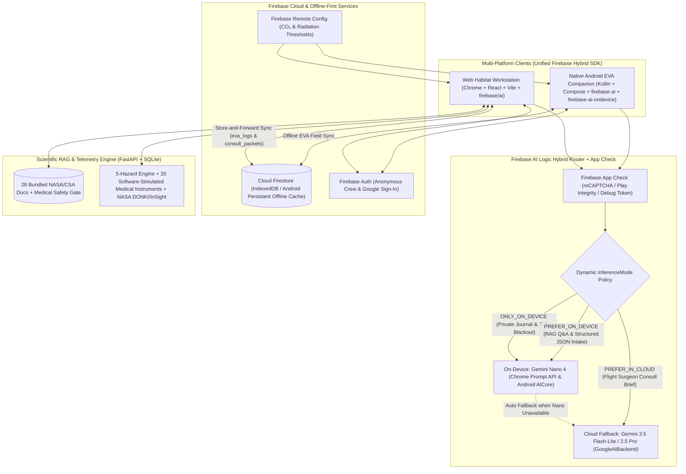

# TARS Care — Hybrid On-Device & Cloud Astronaut Health Companion

[](LICENSE)

> **#BuildHybridAI 2026 · Team Milky Has Its Own Way (`CHAI` & `TanSuChin`)**
>
> A **multi-platform (`Web on Chrome` + `Native Android EVA Companion`)**, offline-first astronaut health-monitoring, self-assessment, and medical decision-support suite powered by the **Firebase AI Logic Hybrid Inference SDK** (`Gemini Nano 4` on-device + `Gemini Cloud` fallback), **Firebase App Check**, **Cloud Firestore** Store-and-Forward offline persistence, **Firebase Authentication**, and **Firebase Remote Config**.

TARS Care (*Telemetry, Autonomous Risk & Spaceflight Care*) unifies physiological and psychological telemetry, personal baseline tracking, five-hazard spaceflight analysis, crew medical operations, and a citation-backed Retrieval-Augmented Generation (RAG) assistant across **habitat workstations (`Web / Chrome`)** and **field wrist/handheld pads (`Android`)**. Built to operate seamlessly across **Connected**, **Delayed (4–22 min Mars light-time)**, and **Offline (Solar Conjunction Blackout)** link states, it answers three urgent questions at a glance: **How am I doing?**, **What has changed?**, and **Should I take any action?**

> **Earth-Analog Impact:** Beyond deep-space missions, the exact same hybrid architecture serves remote expedition medicine, submarine crews, polar research stations, offshore platforms, and disaster-response triage operating under intermittent connectivity and strict patient privacy constraints.

---

## What Was Built During `#BuildHybridAI 2026` (Existing App Disclosure)

Per **Official Rules Section 6 (New & Existing Projects)**, TARS Care builds upon our team's pre-existing NASA Space Apps prototype (`TanSuChin/NASASpaceChallenge2026-Milky_Has_Its_Own_Way`, originally Python FastAPI + SQLite + backend Groq/Ollama) and was **significantly re-architected during the `#BuildHybridAI 2026` submission period**:

1. **Client-Side Firebase AI Logic Hybrid Inference Engine ([frontend/src/lib/firebaseHybridAI.ts](frontend/src/lib/firebaseHybridAI.ts)):**
   - Replaced legacy backend-only Groq/Ollama toggling with runtime **`firebase/ai`** (`getAI`, `GoogleAIBackend`, `getGenerativeModel`, `InferenceMode`, `InferenceSource`, `Schema`) executing **Gemini Nano 4** locally in Chrome and seamlessly falling back to **Cloud Gemini (`gemini-3.5-flash-lite` / `gemini-2.5-flash` / `gemini-2.5-pro`)**.
   - Added live **`initializeDeviceModel()`** Chrome Gemini Nano 4 download/warmup monitoring and real-time runtime `result.response.inferenceSource` telemetry badges (`ON_DEVICE` vs. `IN_CLOUD`).
2. **Four Domain-Authentic Hybrid AI Workflows:**
   - **`InferenceMode.PREFER_ON_DEVICE` Medical RAG ([AIHealthAssistantView.tsx](frontend/src/components/AIHealthAssistantView.tsx)):** Synthesizes retrieved excerpts from 28 NASA/CSA research documents locally on Gemini Nano 4 with zero token cost and zero network latency, falling back to Cloud Gemini on browsers/devices without Nano 4.
   - **`InferenceMode.ONLY_ON_DEVICE` Zero-Egress Private Journal & Companion ([PersonalCompanionView.tsx](frontend/src/components/PersonalCompanionView.tsx)):** Enforces strict local execution so crew mental-health reflections and PIN-gated journals **never transmit over the network or leave device memory**.
   - **Hybrid Structured JSON Intake (`Schema.object` + `PREFER_ON_DEVICE`, [HealthAssessmentView.tsx](frontend/src/components/HealthAssessmentView.tsx)):** Parses freeform natural-language/voice post-EVA logs directly into typed TARS Care vitals (`BPM`, `mmHg`, `SpO₂ %`, `CO₂ mmHg`) and selectable symptom chips both on-device and in-cloud.
   - **`InferenceMode.PREFER_IN_CLOUD` Flight Surgeon Executive Brief ([CrewMedOpsView.tsx](frontend/src/components/CrewMedOpsView.tsx)):** Synthesizes longitudinal multi-Sol consultation briefs via Cloud Gemini when Deep Space Network link is active, falling back to on-device inference during blackout.
3. **Full Supporting Firebase Suite (`App Check` + `Firestore` + `Auth` + `Remote Config`):**
   - **Firebase App Check:** Configured with reCAPTCHA v3 / Enterprise + `FIREBASE_APPCHECK_DEBUG_TOKEN` / Android `DebugAppCheckProviderFactory` support for local and judge testing.
   - **Cloud Firestore Store-and-Forward ([firestore.rules](firestore.rules)):** Wired TARS Care's `Connected` / `Delayed` / `Offline (Blackout)` switch directly to Firestore `enableNetwork()` / `disableNetwork()` with IndexedDB `persistentLocalCache`, queuing consult packets and EVA logs offline (`hasPendingWrites`) and syncing automatically upon reconnection.
   - **Firebase Authentication & Remote Config:** Zero-friction anonymous crew session + optional Google Sign-In, plus Remote Config mission hazard thresholds (`co2_warn_mmhg`, `rad_warn_msv`, `cloud_fallback_model`).
4. **New Native Android EVA Companion App ([android/](android/)):**
   - Built a native **Kotlin + Jetpack Compose** Android field companion (`space.tarscare.eva`) powered by **`com.google.firebase:firebase-ai:18.2.0`** + **`com.google.firebase:firebase-ai-ondevice:16.0.0-beta08`**, running **Android Gemini Nano 4 (AICore)** for suit telemetry triage (`PREFER_ON_DEVICE`) and private crew journaling (`ONLY_ON_DEVICE`), synced live with the Web Habitat Console via **Cloud Firestore (`eva_logs`)**.
5. **Open-Source Licensing & Repository Hygiene:**
   - Licensed under **Apache License 2.0** ([LICENSE](LICENSE)), untracked all build caches/`node_modules`, and verified zero committed secrets.

---

## Multi-Platform Hybrid Architecture



---

## Project Structure

```text
.
├── android/                        # Native Android EVA Companion (Kotlin + Jetpack Compose)
│   ├── app/
│   │   ├── build.gradle.kts        # firebase-ai:18.2.0 + firebase-ai-ondevice:16.0.0-beta08 + App Check
│   │   ├── google-services.json.example
│   │   └── src/main/java/space/tarscare/eva/
│   │       ├── MainActivity.kt             # 3-tab Compose Spacecraft UI (EVA Triage, Journal, Sync)
│   │       └── TarsCareHybridEngine.kt     # Android Hybrid AI Router, App Check, Firestore & Remote Config
│   ├── build.gradle.kts
│   └── settings.gradle.kts
├── backend/                        # Python FastAPI Scientific Retriever, 5-Hazard Engine & Safety Verifier
│   ├── assessment_engine.py        # 5-hazard rules, baseline deltas, EVA readiness & predictive runways
│   ├── database.py                 # SQLite schema & 30-Sol Ares-Horizon IV crew telemetry seeder
│   ├── hardware_devices.py         # 20 software-simulated / CSV-imported medical device adapters
│   ├── knowledge_base.py           # 28 offline NASA/CSA research references & lexical retriever
│   ├── local_ai_rag.py             # Dense+lexical hybrid scorer & non-prescribing safety gate
│   ├── main.py                     # FastAPI entrypoint & /api/* endpoints
│   ├── marscare_routes.py          # Extended assessment, history, comm & RAG routes
│   ├── support_modules.py          # Food/water inventory, comm queue & private journal persistence
│   └── tests/test_tarscare_safety.py
├── frontend/                       # Web Habitat Workstation (React 18 + TypeScript + Vite + Tailwind)
│   ├── .env.example                # Clean Firebase AI Logic & App Check env template (no secrets)
│   ├── src/
│   │   ├── lib/firebaseHybridAI.ts # Firebase AI Logic Hybrid Router, App Check, Auth, Firestore, Remote Config
│   │   ├── components/             # 11 Spacecraft views + AIProviderSwitcher Hybrid Mission Console
│   │   └── App.tsx
│   └── package.json
├── firebase.json                   # Firebase Hosting & Cloud Firestore configuration
├── firestore.rules                 # Crew-authenticated rules blocking private journal cloud writes
├── vercel.json                     # Single-origin Vercel Services deployment (Frontend + FastAPI)
└── LICENSE                         # Apache License 2.0
```

---

## Getting Started & Judge Testing Instructions

> **Hardware Requirement Notice:** All 20 medical instruments in TARS Care are **100% software-simulated or CSV/JSON-imported** on standard consumer desktop/laptop Chrome browsers and standard Android phones/emulators. **No proprietary or specialized hardware is required.**

### 1. Firebase Project & App Check Setup (Shared Across Web & Android)

1. In the [Firebase Console](https://console.firebase.google.com/), create or select a Firebase project:
   - Open **AI Logic** → click **Get started** and enable the **Gemini Developer API** (`GoogleAIBackend`).
   - Open **App Check** → register your Web app (reCAPTCHA v3/Enterprise) and Android app; for local or judge testing, register a debug token (**debug tokens are accepted per `#BuildHybridAI` rules**).
   - *(Recommended)* Enable **Authentication → Anonymous** (and Google), **Cloud Firestore**, and **Remote Config** (`co2_warn_mmhg = 3.0`, `rad_warn_msv = 50`, `cloud_fallback_model = "gemini-3.5-flash-lite"`).
2. **Enable Chrome Built-in Gemini Nano 4 (Optional for Local On-Device Web Inference):**
   - In Chrome Desktop (`138+`), enable `chrome://flags/#optimization-guide-on-device-model` (`Enabled BypassPerfRequirement`) and `chrome://flags/#prompt-api-for-gemini-nano-multimodal-input` (`Enabled`), relaunch Chrome, then click **`Warm Up Nano 4`** inside the TARS Care toolbar.
   - *If Gemini Nano 4 is unavailable on the test machine, `InferenceMode.PREFER_ON_DEVICE` automatically falls back to Cloud Gemini via Firebase AI Logic!*

### 2. Run the Web Application (`Web / Chrome`)

```bash
# 1. Start FastAPI scientific telemetry & RAG backend (http://127.0.0.1:8000)
cd backend
pip install -r requirements.txt
python -m uvicorn main:app --host 127.0.0.1 --port 8000
```

```bash
# 2. Configure & start React + Vite frontend (http://127.0.0.1:5173)
cd frontend
cp .env.example .env.local   # Add your public Firebase Web config (or paste at runtime in the UI!)
npm install
npm run dev -- --host 127.0.0.1 --port 5173
```

- **Zero-Friction Judge Testing:** Even without creating `.env.local`, open **http://localhost:5173** → click **`Firebase Config`** in the AI toolbar → paste your `firebaseConfig` snippet and check **Enable App Check Debug Token** (saved only in browser `localStorage`).

### 3. Build & Run the Native Android EVA Companion (`Android`)

1. Open the [android/](android/) directory in **Android Studio** (or build via Gradle CLI with JDK 17/21).
2. *(Optional)* Copy your Firebase Android `google-services.json` to `android/app/google-services.json` (gitignored), **or** enter `projectId`, `applicationId`, and `apiKey` at runtime in **Tab 3 (`Sync & Config`)** inside the Android app.
3. Build the debug APK:
   ```powershell
   cd android
   .\gradlew.bat assembleDebug
   ```
4. Install on an Android 14+ AICore-capable device (for local Gemini Nano 4) or any Android API 26+ emulator (automatically uses Cloud Gemini fallback or offline deterministic safety rules, and syncs live to the Web Console via Cloud Firestore `eva_logs`).

---

## Automated Verification & Safety Guardrails

Run the automated backend medical safety, RAG citation, unit-integrity (`Gy` vs. `Sv`), and blackout integrity test suite:

```bash
python -m pytest backend/tests/test_tarscare_safety.py -v
```

Run Web TypeScript typechecking and production bundle verification:

```bash
cd frontend
npx tsc --noEmit
npm run build
```

### Core Safety & Compliance Commitments
- **Non-Diagnostic & Non-Prescribing Prototype:** TARS Care is a software decision-support prototype — not clinically certified medical software. Post-generation regex gates strip any medication dosages on both Web and Android, and critical vitals (`SpO₂ < 94%`, `HR ≥ 115 BPM`, cardiopulmonary red flags) automatically suppress routine exercise in favor of **Exercise Hold**.
- **Strict Radiation Unit Separation:** Absorbed physical dose (`Gy` / `mGy`) and biologically weighted equivalent/effective dose (`Sv` / `mSv`) are never conflated.
- **Public Data Attribution & Non-Endorsement:** References publicly available NASA (HRP, OSDR, RadLab, NLSP, EDA, DONKI, InSight) and Canadian Space Agency (TBone, Vascular, CCISS, CARDIOBREATH) research. NASA and CSA do not endorse this independent hackathon project.

---

## Team & License

- **Team:** Team Milky Has Its Own Way (`CHAI` & `TanSuChin`)
- **License:** Distributed under the **Apache License, Version 2.0**. See [LICENSE](LICENSE) for full terms.
